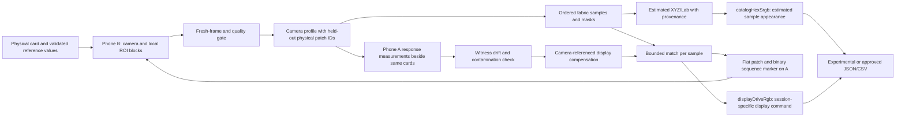

# Architecture and Scientific Boundaries

## Why This Stack

React/TypeScript/Vite handles camera permission, local lossless sampling, interactive native-coordinate masks, role pairing, and strictly flat display output. FastAPI serves one same-origin application and coordinates authenticated sessions. NumPy/SciPy perform robust statistics and bounded fitting; colour-science supplies tested color differences/adaptation; Pillow/LittleCMS reads embedded ICC. An independent project avoids inheriting the existing renderer's assumption that matching generated pixels proves physical fabric accuracy.

No production-site dependencies, material-generation model, remote AI service, RAW claim, instrument connection, or operating-system brightness controller. All external libraries are installed with lockfiles. Reference image bytes remain immutable.

## Flow

The graph has **no `displayDriveRgb -> catalogHexSrgb` edge**. The display loop compares camera-domain responses and preserves the sample estimate frozen before the loop. Neither match success nor visual agreement upgrades a measurement to independent instrument validation.

## Color Domains

| Domain | Contract |
|---|---|
| Uploaded image bytes | Actual embedded ICC read on server; absent profile explicitly assumed; unsupported profile rejected |
| Live camera/video | Browser-processed output, declared Canvas color space; no RAW or sensor radiometry |
| Canonical measurement | Float linear RGB and XYZ; source conversion once; out-of-sRGB values must not be silently clipped during inference |
| Camera model | Regularized 3x3 baseline and physically separated holdout; validation is estimated, condition-specific |
| Reference values | Named white D50/D65, observer, source/version, scale Y=1; unsupported observer not silently substituted |
| Catalog | D65 sRGB encoding; gamut status and clipping/mapping warning accompany HEX |
| Preview | Canonical sRGB derivative explicitly tagged; original P3 ICC must not be applied twice |
| Display drive | Normalized [0,1] requested RGB, not measured absolute luminance, not an ICC profile |
| Display error | Camera-domain objective; surrogate estimated ΔE only with a usable camera profile |
| Instrument error | `null` until independently measured under recorded compatible conditions |

Surface gloss, translucency, backing and fabric direction can make a single representative value misleading. No RGB image reconstructs a reflectance spectrum or missing clipped channel. Disjoint regions with close colors remain distinct by physical sample identity.

## Security and Synchronization

One server process, expiring high-entropy session/role tokens, exact origin matching. Camera and display privileges are distinct. WebSocket first-message authentication avoids URL query logs. IDs, monotonic sequences, profile versions and command sequences bind a response to the requested patch. Controls are bounded; full-frame data is not streamed over WebSocket. Visibility loss, track end, timeout and disconnect pause rather than replaying stale work.

Binary marker observations add camera-frame consistency; they do not establish that a malicious client sent genuine camera data. This local lab trusts its operator, not anonymous internet clients. It is not hardened for public multi-tenant deployment. HTTPS, private LAN and non-forwarded ports are required for two-phone operation.

## Invalidation

Camera/lens/capture path, light, exposure/white-balance settings, reference card, backing, layers, direction, display color/brightness settings or geometry changes require relevant reacquisition. The server invalidates downstream profiles and old result eligibility. Hidden firmware changes may not be detectable; witness drift and operator checks are necessary. A requested lock is not reported as a verified lock.

## Scope and Acceptance

The delivered baseline is a local browser lab, not a certified calibrated instrument. It must support the complete three-stage route and explicitly requested replay/catalog-only alternatives. Profiles and exported provenance must describe limitations. Reference-free work is exploratory. Numerical, synthetic device and real-image parsing tests are separate from unperformed hardware verification.

Native iOS/Android RAW acquisition, verified sensor-control APIs, direct colorimeter integration, reflectance spectroscopy and absolute luminance calibration require future, device-specific work. Their absence must be visible rather than simulated.

## Sources Consulted

- Browser capabilities and their variability: https://developer.mozilla.org/en-US/docs/Web/API/MediaStreamTrack/getCapabilities
- Canvas source/return color-space and Float16 options: https://developer.mozilla.org/en-US/docs/Web/API/CanvasRenderingContext2D/getImageData
- Fresh video callback semantics and lack of strict frame synchronization guarantees: https://developer.mozilla.org/en-US/docs/Web/API/HTMLVideoElement/requestVideoFrameCallback
- LittleCMS-backed ICC handling: https://pillow.readthedocs.io/en/stable/reference/ImageCms.html
- Standard CIEDE2000 and textile weighting distinction: https://colour.readthedocs.io/en/develop/generated/colour.difference.delta_E_CIE2000.html
- Sharma/Wu/Dalal standard test pairs: https://hajim.rochester.edu/ece/sites/gsharma/ciede2000/dataNprograms/ciede2000testdata.txt
- Same-server WebSocket design: https://fastapi.tiangolo.com/advanced/websockets/
- Local trusted test certificates: https://github.com/FiloSottile/mkcert

Documentation consultation is not a compatibility test of any phone.
